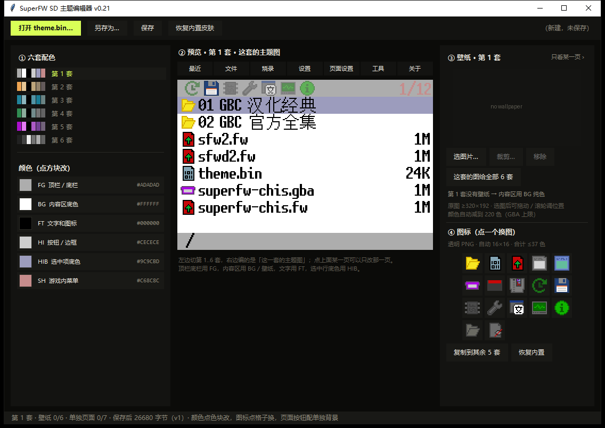

# SuperFW SD 主题编辑器

*中文 · [English](README.en.md)*

给 GBA 烧录卡固件 **SuperFW** 做 SD 卡主题包的工具。

调好配色、图标、背景，存成 `theme.bin` 丢进 SD 卡，重开机就是新界面 —— **固件只刷一次，之后只换卡上的文件**。

## 三步

1. 从 [Releases](../../releases) 下载 exe，双击运行
2. 调好之后「另存为…」存成 `theme.bin`
3. 拷到 SD 卡的 `/.superfw/` 目录，插卡开机

卡上没有这个文件也没关系，固件第一次开机会自动生成一份默认的，之后覆盖它就行。

## 能改什么

| 项目 | 内容 |
|---|---|
| 配色 | 6 套，每套 6 个角色（顶栏/底栏、内容区、文字、边框、选中行、游戏内菜单） |
| 图标 | 6 套，每套 17 个，可逐格替换 |
| 背景 | 6 套壁纸；另外菜单顶部 **7 个标签页可以各配一张**，不配就跟随当前套 |

预览是用固件自己的点阵字库和布局画的，不是示意图 —— 字号、哪里会被截断，都和真机一致。
一共能预览 **14 个界面**：7 个主页面，加上游戏内菜单、载入信息、补丁选项、载入选项、
烧录 NOR、文件管理和载入画面。

### 图片规格

| 项目 | 规格 |
|---|---|
| 壁纸 | 建议 **320×192 或更大**（5:3）。工具裁成 240×144，颜色减到 220 色；底栏最多盖住底部 16 行，安全构图区 **240×128**。 |
| 图标 | **16×16 透明 PNG**；六套图标合计最多 37 色。 |

## 思路来源

主题放 SD 卡、跟固件分离，这个做法来自 [ZaindORp 的 EZ-FLASH OMEGA DE 内核](https://github.com/orzgithub/omega-de-kernel_ZaindORp)。

好处是改主题不用刷机：改坏了删掉文件就回落成内置皮肤，固件升级也不用重做主题。

## 许可与致谢

GPL-3.0，见 [LICENSE](LICENSE)。`fw/` 是 [SuperFW](https://superfw.davidgf.net/)（davidgf）的衍生代码。

- **davidgf** —— SuperFW 固件作者
- **moribaka** —— [superfw-fix](https://github.com/moribaka/superfw-fix) 固件分支
  （本项目的固件基于它的补丁引擎与数据库）
- **ZaindORp** —— SD 卡主题这套思路的来源
- **文泉驿** —— [点阵宋体 10pt](https://wenq.org)，固件里的中文字形
- **Fusion Pixel** —— [像素字体](https://github.com/TakWolf/fusion-pixel-font)，补缺字（OFL-1.1）
- **Electr0Whale** —— 把这两套字体打包成固件的点阵格式
  （[superfw 的 `wqy10pt-font` 分支](https://github.com/Electr0Whale/superfw)）

制作：**小米粥不糊**
